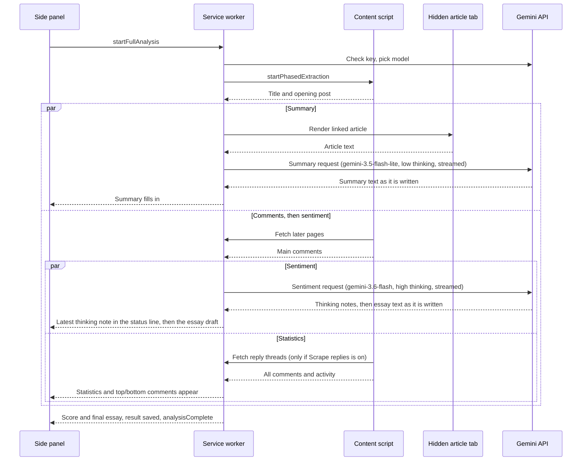

# GirlsinSight

GirlsinSight is a Chrome extension that reads a [GirlsChannel](https://girlschannel.net/) (ガールズちゃんねる) topic and explains what the community thinks about it. It collects every comment in the thread, works out where users agree and where they are divided, and asks Google Gemini to write a qualitative sentiment analysis that weighs the most upvoted comments against the most downvoted ones. It is built for academic, journalistic, market and sociocultural research.

**[Install from the Chrome Web Store](https://chromewebstore.google.com/detail/girlsinsight/bbfnanleibeenpgheblpplenipaeamkp)** · Version 1.5.0 · Manifest V3 · Japanese and English

## Contents

- [What it produces](#what-it-produces)
- [Installation](#installation)
- [Setup](#setup)
- [Using GirlsinSight](#using-girlsinsight)
- [Settings](#settings)
- [How it works](#how-it-works)
- [Metrics](#metrics)
- [Excel export](#excel-export)
- [Permissions](#permissions)
- [Privacy](#privacy)
- [Development](#development)
- [Troubleshooting](#troubleshooting)
- [License](#license)

## What it produces

GirlsinSight runs in Chrome's side panel next to the topic you are reading. Each analysis fills in four sections, each one appearing as soon as it is ready:

| Section | What it shows |
|---|---|
| **Summary** | A summary of the news article linked in the topic's opening post, with a link to the source (or to an archived copy if the original is gone). If no article can be read, Gemini instead interprets the topic title and opening post. |
| **Statistics** | Comment counts, a consensus score, a controversy score, an activity score and how long the topic has been running. |
| **Top and bottom comments** | The most upvoted and most downvoted comments, with vote counts and dates. Long comments are shortened to 200 characters, and image-only comments are shown as images. |
| **Sentiment analysis** | A roughly 500-word essay on community sentiment and its sociocultural context, plus an overall label (positive, neutral, negative) and a score from 0 to 10. The essay appears as Gemini writes it. If Gemini does not finish, the panel says so and shows no score rather than a guessed one. |

When the analysis finishes, you can download everything as a formatted Excel workbook. The result is also saved, so reopening the side panel on that topic shows it again. Both the interface and Gemini's output can be in Japanese (the default) or English.

## Installation

### From the Chrome Web Store (recommended)

Install GirlsinSight from its [Chrome Web Store listing](https://chromewebstore.google.com/detail/girlsinsight/bbfnanleibeenpgheblpplenipaeamkp), then follow [Setup](#setup).

### From source

1. Clone this repository: `git clone https://github.com/JGKarlin/girlsinsight.git`
2. Open `chrome://extensions/` in Chrome.
3. Turn on **Developer mode** (top right).
4. Click **Load unpacked** and select the cloned `girlsinsight` folder.

There is no build step. The extension runs directly from these files.

## Setup

GirlsinSight uses your own Google Gemini API key. A key from a project without billing uses Gemini's free tier; a key from a project with billing is charged under Google's terms.

1. Create a key in [Google AI Studio](https://aistudio.google.com/app/apikey). For free use, create it in a **new project** and do not link billing to that project. A project with Prepay billing stops when its credits reach $0 and does not fall back to the free tier.
2. Open a GirlsChannel page and click the GirlsinSight toolbar icon to open the side panel. You can also right-click the icon and choose **Settings**.
3. Paste the key into **Gemini API Key** and click **Verify**. This checks the key and that it can use a supported Gemini model.
4. Choose an output language and adjust the analysis settings if you want to.

Settings save automatically as you change them. The API key is stored on this device only; the other settings sync with your Chrome profile.

## Using GirlsinSight

1. Open any GirlsChannel topic page, for example `https://girlschannel.net/topics/1234567/`.
2. Open the side panel. It shows the topic's title, comment count and post date. You can start from any page of a topic; the analysis always reads it from page 1.
3. Click **Analyze Topic**.
4. If the opening post links to an article, Chrome asks whether GirlsinSight may read that site and the Internet Archive (used when the link is dead). Once allowed, Chrome does not ask again for that site. If you decline, the analysis still runs, the summary is based only on the topic title and opening post, and the panel does not ask again until you reopen it.
5. Watch the progress messages. The summary usually appears first, then the statistics and comment lists, then the sentiment essay, which is filled in as Gemini writes it.
6. Click **Download Excel** to save the report.

Click **Stop Analysis** at any time to cancel. The extension stops extracting, cancels pending Gemini requests and closes any article tab it opened. Closing the side panel cancels a running analysis the same way. The side panel resets when you move to a different topic and turns off when the tab leaves GirlsChannel. When you come back to a topic you have analyzed, its saved result is shown with the time it was saved; click **Analyze Topic** to run a fresh one.

## Settings

| Setting | Default | Range | Effect |
|---|---|---|---|
| Gemini API Key | none | | Required. Stored in Chrome local storage on this device only (not synced). Keys saved by version 1.4 or earlier are moved there automatically. |
| Output language | Japanese | Japanese, English | Language of the interface, the Gemini output and the Excel report. |
| Auto comment calculation | On | | Picks how many comments to analyze from the size of the topic. See [Sample size](#sample-size). |
| Comments to analyze | 30 | 5–1,000 | Total comments sent for sentiment analysis when auto calculation is off, split evenly between the most upvoted and most downvoted. |
| Comments to display | 5 | 0–10 | How many top and bottom comments the results panel lists. |
| Scrape replies | Off | | Also downloads reply threads (件の返信) and includes them in the comment totals, activity score, comment lists and export. Replies are numbered under their parent, for example `35.1`, `35.2`. Makes analysis slower on busy topics. |

## How it works

### Components

| File | Role |
|---|---|
| `manifest.json` | Manifest V3 configuration: permissions, side panel, service worker and content script. |
| `background.js` | Service worker. Runs the analysis from start to finish: checks the API key and picks a model, calls Gemini, computes statistics, retrieves articles, saves results and builds the Excel file. |
| `content.js` | Content script injected into GirlsChannel pages. Reads topic metadata and comments, starting from the topic's first page, follows pagination and fetches reply threads. |
| `girlschannel-parsing.js` | Shared helpers for GirlsChannel pages: topic page addresses, Japan-time dates and comment ordering. Used by the content script, the side panel and the service worker. |
| `popup.html`, `popup.js`, `popup.css` | Side panel interface: settings, topic card, Analyze/Stop button, progress messages and download. |
| `popup-react.js` | React components that render the results sections as partial results arrive. |
| `article-pipeline.js` | Decides which linked URLs to try and in what order, works out which sites to ask permission for, combines multi-page articles and falls back to the Wayback Machine. |
| `rendered-article-session.js` | Loads each article in a hidden browser tab, waits for the page to finish rendering and extracts its text. |
| `_locales/` | Japanese and English strings. |
| `lib/` | Bundled third-party libraries: React, ReactDOM, Mozilla Readability and SheetJS. |

### Analysis workflow



1. **Topic detection.** On any topic page (`/topics/<id>/` or a later page such as `/topics/<id>/2/`), the content script reads the title and comment count for the topic card. The post date and the article links come from the topic post, which is on page 1; on a later page, page 1 is fetched when the side panel opens.
2. **Start.** Clicking **Analyze Topic** asks for access to the linked article's site (see [Permissions](#permissions)), assigns the run a unique ID, opens a connection that cancels the run if the panel closes, and passes the current settings to the service worker. Only one analysis runs at a time.
3. **Key check.** The service worker lists the Gemini models the key can use and picks one (see [Gemini API usage](#gemini-api-usage)). An invalid key, or a key with no usable model, stops the run with a clear message before any comments are read.
4. **Opening post first.** The content script loads page 1 if you are on a later page, then sends the topic title, page-1 URL, post date and opening post right away, so the summary can start while the rest of the thread is still being read.
5. **Summary, in parallel.** If the opening post links to an external page and site access was granted, the [article pipeline](#article-retrieval) retrieves up to 15,000 characters of article text and Gemini summarizes it in under 300 words. Otherwise Gemini interprets the title and opening post in under 200 words. Either way the summary is one continuous text, without sections, headings or labels. It is streamed, so the panel fills it in as it is written.
6. **Full extraction, in parallel.** The content script walks every page of the topic from page 1, fetching later pages through the service worker with a 200 ms pause between pages. For each comment it records the number, date (read as Japan time, which GirlsChannel uses), upvotes, downvotes, text and any links. An image-only comment is recorded as its image URL. If **Scrape replies** is on, the main comments are sent to the service worker first, so the essay can start, and then reply threads are fetched five at a time with a 300 ms pause between batches. Comments are then de-duplicated, sorted by number with replies in order under their parent, and given an activity score.
7. **Statistics.** As soon as every comment has been read, including reply threads if they are included, and without waiting for the summary, the service worker drops empty comments, works out each comment's net score and upvote ratio, and sends the statistics and the top and bottom comment lists to the panel.
8. **Sentiment, alongside the summary.** The essay needs only the main comments, so it starts as soon as they are read, while the summary may still be running and, with **Scrape replies** on, before the reply threads have been fetched. The status line shows the step still running: the sentiment request while the essay is being written, then the summary request if the summary is still on its way. Most of the essay's time is Gemini thinking before it writes anything: in a November 2026 test, about 25 seconds of thinking at the high level against about 5 seconds of writing. Meanwhile Gemini sends short notes on what it is thinking about, and the status line adds the heading of the latest one, for example "Processing sentiment analysis... Thinking: Weighing the downvoted comments". Headings are in Gemini's own words, usually English. Once the essay starts arriving, the note is dropped. The notes are never part of the essay. The service worker chooses a sample of main comments (see [Sample size](#sample-size)): half from the top by net score and half from the bottom. Each comment is cut to 1,000 characters and labeled with its vote counts. Gemini is told to treat heavily upvoted comments as the majority view and heavily downvoted comments as views the community rejects. It writes a continuous essay of about 500 words and ends with a `Sentiment:` line and a `Score:` line. The essay is streamed, so the panel fills it in as it arrives. The extension reads only those closing lines, sets the label from the score (0–3 negative, 4–6 neutral, 7–10 positive) and removes them from the essay text. If Gemini's reasoning uses up the output limit before the essay finishes, the request is tried once more with less reasoning. If it still cannot finish, or the essay has no score, the panel shows no score and says why.
9. **Completion.** The result is saved in local storage (the five most recent topics are kept) and the panel shows the download button.

Long runs keep the service worker alive with a lightweight ping every 20 seconds. Every step listens to one cancellation signal, so **Stop Analysis**, or closing the panel, takes effect wherever the run is.

### Article retrieval

News pages are hard to read reliably. Many load their text with JavaScript, split articles across several pages, or sit behind consent walls. GirlsinSight therefore renders each article in a real tab instead of downloading raw HTML.

**Choosing candidates.** URLs come from the opening post. GirlsChannel's own source link is tried first, then links in the comment body, then plain-text URLs. Each candidate is cleaned: trailing punctuation (including Japanese brackets and punctuation) is removed, links back to GirlsChannel and direct links to images, video, PDFs and similar files are dropped, and fragments and tracking parameters (`utm_*`, `fbclid`, `gclid` and others) are stripped. Duplicates are skipped.

**Rendering.** A single inactive, muted tab is opened and reused for every page. For each URL the session:

1. waits until the new page is readable: its HTML has been parsed (checked every 250 ms) or Chrome reports it loaded, whichever comes first, for up to 15 seconds. The story is usually on the page long before every ad has loaded (on Oricon, 0.2 seconds against 2 seconds in a visible tab). A page that is still not readable after 15 seconds is read anyway, and a timeout is reported only if no article is found;
2. waits for the content to settle, checking the length of the page's text every 250 ms until it stops changing (for up to 8 seconds), even if the page is still loading ads;
3. injects Mozilla Readability and extracts the article. Readability's result is preferred, unless it has fewer than a third as many sentences as the page's article container (on some busy pages Readability picks the site menu and ads); then the `articleBody` field in the page's structured data (JSON-LD), then the longest visible article container.

Text shorter than 180 characters is not treated as an article. Each page is capped at 40,000 characters. The extractor also recognizes bot checks and ad-block walls ("blocked"), subscription prompts ("partial") and "page not found" or "article deleted" messages in English and Japanese.

**Multi-page articles.** The session follows `rel="next"` links or links labeled 次のページ, 続きを読む, "next page" and similar, on the same site, for up to 10 pages. It stops when a page no longer looks like the same article (judged by canonical URL or title), or when 15,000 characters have been collected. Repeated paragraphs are removed.

**Deciding a link is dead.** While each page renders, a background HEAD request checks the URL's HTTP status without cookies, giving up after 2.5 seconds. A candidate counts as dead only if that request returns 404 or 410 *and* no article could be extracted. A successfully rendered article is always used, whatever the status check says.

**Wayback Machine fallback.** The Internet Archive is consulted only after every live candidate has been tried, and only for candidates confirmed dead. The most recent archived HTML snapshot is found with the Wayback CDX API, falling back to the availability API, and is rendered in the same tab. The summary then links to both the original URL and the archived copy.

**Excerpt.** Text longer than 15,000 characters is shortened for Gemini by keeping about the first two-thirds and the last third, cut at paragraph or sentence boundaries, with `[…]` marking the gap. The tab is closed when retrieval succeeds, fails or is cancelled.

### Gemini API usage

All requests go directly from your browser to `https://generativelanguage.googleapis.com/v1beta/`. The API key is sent in the `x-goog-api-key` header, never in a URL.

| Purpose | Model | Settings |
|---|---|---|
| API key check | | `GET /models` (lists the models the key can use) |
| Summary | `gemini-3.5-flash-lite`, then the Flash models | `streamGenerateContent`, thinking level `LOW`, up to 8,192 output tokens |
| Sentiment essay | `gemini-3.6-flash`, then `gemini-3.5-flash-lite` | `streamGenerateContent`, thinking level `HIGH` (one retry at `MEDIUM` if cut off), thinking notes on (`includeThoughts`), up to 64,000 output tokens |

The essay is the main result, so it goes to a Flash model, `gemini-3.6-flash`, with the deepest thinking and room for up to 64,000 output tokens (thinking included). `gemini-3.8-flash` is not used: on the free tier Google refused nearly every request to it with a 503 "high demand" error (November 2026), so trying it first only cost time and showed a "busy" message on almost every run. The summary goes to `gemini-3.5-flash-lite`, Google's fastest 3.5 model, with low thinking. Both are streamed, so the panel shows them as they are written.

**Free-tier limits.** Each model has its own limits. On the free tier (November 2026) each Flash model allows 5 requests a minute and 20 a day; each Flash-Lite model allows 15 a minute and 500 a day. Sending the summary to Flash-Lite means an analysis uses one Flash request instead of two. Your project's current limits are on the Rate Limit page in Google AI Studio.

**Model choice.** The key check lists the models the key can use. The essay's list is `gemini-3.6-flash` (or, if the key cannot use it, the newest stable `gemini-X.Y-flash` from 3.6 on, the first versions that accept this request format), then other such Flash models, newest first, except `gemini-3.8-flash`, then Flash-Lite models from 3.5 on. The summary's list is the same models with Flash-Lite first. A key with no usable model is stopped at the start with a clear message.

**Moving to another model.** A request moves straight on to the next model on its list when the current one is busy (a 503 "high demand" error, or no answer in time), has used up today's free requests, asks for a wait longer than 30 seconds, or rejects the thinking setting. The panel says which model is busy or out of free requests and which one it tries next. The extension remembers such a model in local storage and skips it in later runs: for 10 minutes after "busy", until Google's daily reset at midnight Pacific time (5 pm in Japan, 4 pm during US daylight saving time) after a used-up daily limit, for the wait Gemini asked for after a long rate limit, and for a day after a rejected setting. If every model on a list is being skipped, they are tried anyway.

**Retries.** A request is tried up to three times, but only when a retry can help: network errors and server errors (waiting 1 second, then 2), a busy Gemini, and per-minute rate limits, which wait as long as Gemini asks (up to 30 seconds). A model that is out of free requests or asks for a longer wait is replaced by the next model on the list; if there is none, the limit is reported at once. An invalid key, depleted prepaid credits, a missing model, a refused request, a blocked or safety-stopped reply, or a reply cut off at the token limit fails at once, since repeating it would cost tokens without changing the outcome. A reply cut off at the token limit is never shown as if it were complete. If the first request (the summary) finds the key invalid or its prepaid credits depleted, the run stops there, since the sentiment request would fail the same way.

**Busy periods.** Gemini serves free-tier requests from capacity it sheds first under heavy demand, so free-tier keys can get a 503 "high demand" error or no answer at all; the newest model is turned away most. A request is treated as busy, and moves to the next model as described above, if the reply has not started within 90 seconds, or if Gemini goes quiet for 30 seconds once it has started. The first limit is longer because Gemini thinks before it writes, and the essay's thinking can take well over 30 seconds on the free tier; its thinking notes arrive only now and then, so they do not count as the reply starting.

**Request format.** Sampling parameters such as `temperature` are not sent, because current models ignore them. The four adjustable safety filters (harassment, hate speech, sexually explicit, dangerous content) are set explicitly to `OFF`, so a change to Google's defaults cannot start refusing ordinary forum threads; each prompt also states that the task is research. Every request is sent with `store: false`, which keeps it out of your AI Studio project's request logs, a paid-tier feature that new paid projects turn on by default. It does not change how Google otherwise handles API data under its terms.

### Message flow

The side panel, service worker and content script communicate with `chrome.runtime` and `chrome.tabs` messages. Progress, result and completion messages carry the run's ID, so the panel ignores messages from an earlier or cancelled run.

| Message | From → to | Purpose |
|---|---|---|
| `startFullAnalysis` | panel → worker | Begin a run with the current settings. |
| `startPhasedExtraction` | worker → content | Start reading the topic. |
| `initialDataReady` | content → worker | Title, URL, post date and opening post. |
| `fetchPage` | content → worker | Fetch a later page or a reply thread. |
| `mainCommentsReady` | content → worker | The main comments, sent before reply threads are fetched (only when **Scrape replies** is on and there are replies), so the essay can start. |
| `allCommentsReady` | content → worker | Every comment plus the activity score, or an error. |
| `extractionProgress`, `analysisProgress` | → panel | Status text for the progress line. |
| `partialResults` | worker → panel | `summary`, `stats`, `sentimentDraft` (streamed essay text, at most every 300 ms) or `sentiment` section data. |
| `analysisComplete`, `analysisFailed`, `analysisCancelled` | worker → panel | How the run ended. |
| `abortAnalysis`, `abortExtraction` | panel → worker → content | Cancel the run. |
| port `analysis:<id>` | panel → worker | Held open during a run; Chrome closes it with the panel, which cancels the run. |
| `generateExcel` | panel → worker | Build and download the workbook. |
| `urlChanged`, `showWelcomeScreen` | worker → panel | Reset the panel after navigation. |

### Localization

The interface and Gemini's output follow the extension's own **Output language** setting rather than Chrome's language, so you can switch without changing browser settings. Strings live in `_locales/ja/messages.json` and `_locales/en/messages.json`. Chrome uses the same files for the extension's name and description, with Japanese as the default.

## Metrics

Consensus, controversy and the sentiment sample use main comments only. When **Scrape replies** is on, replies also count toward the activity score, the duration and the comment lists.

**Net score and upvote ratio.** For each comment, net score = upvotes − downvotes, and upvote ratio = upvotes ÷ (upvotes + downvotes). A comment with no votes gets a ratio of 0.5.

**Consensus score (0–10).** How decisively each comment was voted on, averaged across the topic. Each comment scores `|ratio − 0.5| × 2`, so 0 means an even split and 1 means unanimous. The mean is multiplied by 10. A high score means users tend to agree firmly about individual comments.

| Score | ≥ 8 | ≥ 6 | ≥ 4 | ≥ 2 | < 2 |
|---|---|---|---|---|---|
| Label | High | Moderate | Low | Poor | None |

**Controversy score (0–10).** How widely the voting varies across comments. Each comment's polarity is `(ratio − 0.5) × 2`, from −1 (all downvotes) to +1 (all upvotes). The score is the standard deviation of those polarities × 10. A high score means the thread mixes strongly endorsed and strongly rejected comments.

| Score | ≥ 7 | ≥ 5 | ≥ 3 | < 3 |
|---|---|---|---|---|
| Label | High | Moderate | Low | None |

**Activity score (1–10).** How recently people have been commenting, measured when the analysis runs.

| Score | Condition | Label |
|---|---|---|
| 10 | more than 25 comments in the last hour | On Fire |
| 9 | more than 10 in the last hour | Very Active |
| 8 | more than 50 in the last 24 hours | Active |
| 7 | more than 10 in the last 24 hours | Lively |
| 6 | at least 1 in the last 24 hours | Moderate |
| 5 | more than 10 in the last 7 days | Steady |
| 4 | at least 1 in the last 7 days | Quiet |
| 3 | more than 5 in the last 30 days | Slow |
| 2 | at least 1 in the last 30 days | Dormant |
| 1 | none in the last 30 days | Inactive |

**Duration.** Time elapsed since the earliest comment. All comment times are read as Japan time, the time zone GirlsChannel displays, so these figures are correct wherever you are.

**Top and bottom comments.** The panel lists the comments with the most upvotes and the most downvotes. The sentiment sample instead ranks comments by net score.

### Sample size

With **Auto comment calculation** on, the number of comments sent to Gemini scales with the size of the topic:

```
n = round((0.03 × total + 20) × 2), limited to between 10 and 1,000
```

| Comments in topic | Comments analyzed |
|---|---|
| 300 | 58 |
| 1,000 | 100 |
| 10,000 | 640 |

With auto calculation off, *n* is the **Comments to analyze** setting. Either way, *n* never exceeds the number of main comments, so a small topic is analyzed in full and no comment is sent twice. Replies do not affect *n*. The sample is split with the extra comment going to the upvoted side: `ceil(n/2)` from the top and `floor(n/2)` from the bottom.

## Excel export

**Download Excel** saves `girlsinsight_analysis_<timestamp>.xlsx`, and Chrome asks where to save it. The workbook is built inside the extension with SheetJS and has two sheets, named in the output language:

- **Report:** title, generation time, topic URL, article source (and archived copy, if one was used), summary, sentiment label, score and essay, all statistics, and the top and bottom comments.
- **All comments:** every extracted comment in thread order, with replies in order under their parent if they were scraped, and number, date, upvotes, downvotes, net score, text, links and the topic title on the opening post.

A comment whose date could not be read shows `-`. If the sentiment analysis did not finish, its label and score show `-`.

## Permissions

| Permission | Why it is needed |
|---|---|
| `sidePanel` | Shows the interface in Chrome's side panel. |
| `storage` | Saves preferences (sync storage), and the API key, current topic card and recent results (local storage). |
| `tabs` | Finds the GirlsChannel tab being analyzed and opens, drives and closes the hidden article tab. |
| `scripting` | Injects Readability and the text extractor into the article tab. |
| `downloads` | Saves the Excel report. |
| `contextMenus` | Adds **Settings** to the toolbar icon's right-click menu. |
| `girlschannel.net` | Reads topic pages and fetches later pages and reply threads. |
| `generativelanguage.googleapis.com` | Calls the Gemini API. |
| Optional: the linked article's site and the Internet Archive | Requested when you click **Analyze Topic** and the opening post links to an article, for just that site plus `web.archive.org` and `archive.org`. You can decline it, and remove it later under `chrome://extensions` → GirlsinSight → **Details** → **Site access**. The manifest lists all `http`/`https` sites as optional only so that any article's site can be requested this way. |

## Privacy

GirlsinSight has no server of its own and collects no analytics. When you run an analysis:

- the topic title, opening post, article excerpt and sampled comments are sent to Google's Gemini API using your key. Requests are sent with `store: false`, which keeps them out of your AI Studio request logs; Google's API terms govern its handling otherwise;
- if an article link is dead, its URL is looked up on the Internet Archive's Wayback Machine;
- articles are opened in an inactive tab that is closed afterwards, and the article's site sees an ordinary visit from your browser;
- your API key is kept in local storage on this device, and your other settings in Chrome sync storage;
- the five most recent results, including the comments they analyzed, are saved in local storage on this device so you can reopen them.

The extension only works on GirlsChannel pages you choose to analyze. See the full [privacy policy](privacy_policy_girlsinsight.md).

## Development

There is no build step and no npm dependency. Edit the files, then click the reload icon for GirlsinSight on `chrome://extensions/`.

**Tests.** The suite uses Node's built-in test runner (Node 18 or newer) and needs no packages:

```sh
node --test
```

- `article-pipeline.test.js` and `rendered-article-session.test.js` cover article retrieval and the site permissions requested.
- `girlschannel-parsing.test.js` covers topic page addresses, Japan-time dates and comment ordering.
- `content.test.js` runs the real content script on a small fake topic page and checks that the main comments are sent before reply threads are fetched.
- `background.test.js` loads the real service worker with Chrome APIs and Gemini replaced by fakes (see `test-support/background-harness.js`). It runs whole analyses and checks the sentiment sample and size, streaming, thinking notes, the Gemini request format, retries, the silence limit and error handling, model choice, saved results, settings storage and cancellation when the panel closes.
- `popup-react.test.js` renders result components with the bundled React.
- `packaging.test.js` builds the Web Store zip and checks it contains every file the extension loads and no test files.

GitHub Actions runs the suite on every push and pull request (`.github/workflows/test.yml`).

**Packaging.** `sh scripts/package.sh` builds `dist/girlsinsight-<version>.zip` for upload to the Chrome Web Store, containing only the extension's own files. Bump `version` in `manifest.json` first.

**Debugging.**

- **Service worker:** on `chrome://extensions/`, click **service worker** under GirlsinSight to open its console.
- **Side panel:** right-click inside the panel and choose **Inspect**.
- **Content script:** open DevTools on a topic page and select the GirlsinSight context in the console's context menu. `testReplyDetection()` and `debugPageStructure()` print what the extension sees in the page.
- **Verbose logging:** set `DEBUG_MODE = true` in `background.js` to log each step and show how each article was obtained (rendered or archived, full or partial), and `DEBUG = true` in `content.js` for the content script. Both are off in releases, so a normal run writes nothing to the console log.

**Page structure.** Comment extraction depends on GirlsChannel's HTML: `.comment-item` for each comment, `.body` for text, `.icon-rate-wrap-plus` and `.icon-rate-wrap-minus` for votes, `.pager-topic .next` for pagination and links labeled 件の返信 for replies. If GirlsChannel changes its markup, `content.js` is where to update the selectors.

## Troubleshooting

When an analysis fails, the side panel shows a card in place of the status line. It says what went wrong, why, and the steps to fix it, with buttons that go there: the AI Studio API Keys page, Settings, the API key guide, **Try again** or **Reload page**. If only the sentiment part fails, the summary and statistics stay on screen and the card appears above them. The table below lists the underlying messages.

| Problem | What to check |
|---|---|
| "Please configure your Gemini API key" or "API key required" | Add a Gemini API key in Settings and click **Verify**. |
| "API key is invalid or network error" | Make sure the key is active in Google AI Studio, has quota left and that you are online. An older key that isn't restricted to the Gemini API is now rejected. Create a new key, or in AI Studio choose **Add restrictions › Restrict to Gemini API only**. |
| "This API key can't use Gemini 3.6 Flash or newer" | The key's project does not offer a supported model. Create a key in a project that does, in Google AI Studio. |
| "This API key's Google project uses prepaid billing and its credits have run out" | The key belongs to a project with Prepay billing and a $0 balance; Google blocks such a project instead of moving it to the free tier. Add credits in Google AI Studio, or create a key in a new project without billing and use that. |
| "Gemini is too busy to answer right now" | Gemini turned the request away under heavy demand, even after trying the fallback model. Free-tier requests are turned away first. Try again in a few minutes. |
| "Gemini's rate limit was reached" | Every model the extension tried is out of free requests for now. Free-tier Flash models allow 5 requests a minute and 20 a day each. Wait a minute, or after a used-up daily limit wait for Google's daily reset (5 pm in Japan, 4 pm during US daylight saving time). |
| "The analysis was cut off before it finished" | Gemini used its whole output budget. Run it again, or lower **Comments to analyze**. |
| The side panel does not open | The panel turns off for a tab that has left GirlsChannel. Open a topic page in that tab, or reload it, and try again. |
| Analysis fails at once with a connection error | Reload the topic page. This happens when the extension was installed or updated after the page was opened. |
| "No valid comments found" or "Could not extract comments" | Make sure you are on a topic page (`/topics/<id>/`), not a search or list page, then refresh and try again. |
| Summary ignores the linked article | Site access may have been declined (reopen the panel to be asked again), the link may redirect to a different site than the one you allowed, or the article may be blocked, paywalled or unreadable. Gemini then interprets the opening post instead. |
| The sentiment section is slow | It asks Gemini for its deepest thinking, which takes most of the time (about 25 seconds in testing) before any essay text appears; meanwhile the status line shows what Gemini is thinking about. The essay then appears as it is written. If the essay has not started within 90 seconds, or stops for 30 seconds partway, the request moves on to the next model. Large topics take longer to read before the essay can start. |
| Excel download fails | Check that Chrome allows downloads and that there is disk space. |

## License

GirlsinSight is released under the [MIT License](LICENSE) © 2024 Jason G. Karlin. Please use it in line with GirlsChannel's terms of service.

Bundled third-party libraries keep their own licenses:

| Library | Version | License |
|---|---|---|
| [React and ReactDOM](https://react.dev/) | 18.2.0 | MIT |
| [Mozilla Readability](https://github.com/mozilla/readability) | 0.6.0 | Apache 2.0 (see `lib/LICENSE.md`) |
| [SheetJS Community Edition](https://sheetjs.com/) | 0.18.5 | Apache 2.0 |

## Author

Created by [Jason G. Karlin](https://jgkarlin.org).
