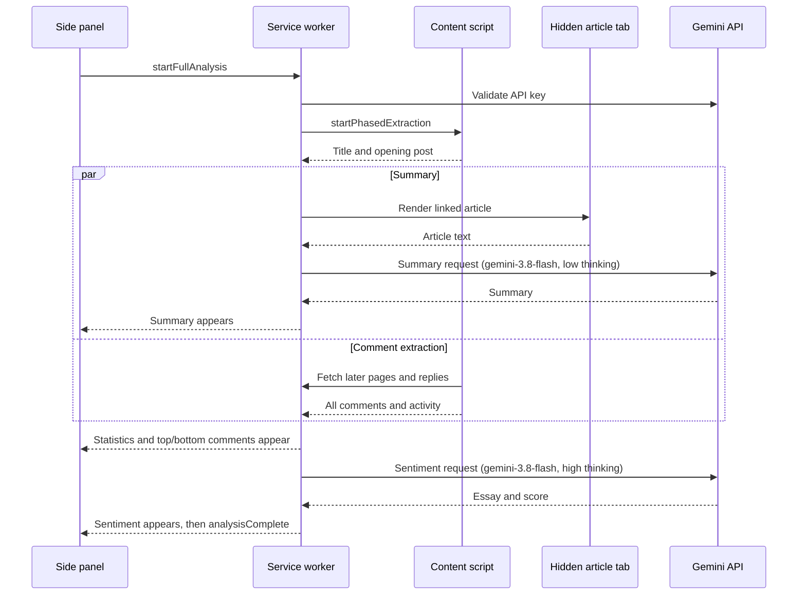

# GirlsinSight

GirlsinSight is a Chrome extension that reads a [GirlsChannel](https://girlschannel.net/) (ガールズちゃんねる) topic and explains what the community thinks about it. It collects every comment in the thread, works out where users agree and where they are divided, and asks Google Gemini to write a qualitative sentiment analysis that weighs the most upvoted comments against the most downvoted ones. It is built for academic, journalistic, market and sociocultural research.

**[Install from the Chrome Web Store](https://chromewebstore.google.com/detail/girlsinsight/bbfnanleibeenpgheblpplenipaeamkp)** · Version 1.4.0 · Manifest V3 · Japanese and English

## Contents

- [What it produces](#what-it-produces)
- [Installation](#installation)
- [Setup](#setup)
- [Using GirlsinSight](#using-girlsinsight)
- [Settings](#settings)
- [How it works](#how-it-works)
- [Metrics](#metrics)
- [Excel export](#excel-export)
- [Permissions](#permissions)
- [Privacy](#privacy)
- [Development](#development)
- [Troubleshooting](#troubleshooting)
- [License](#license)

## What it produces

GirlsinSight runs in Chrome's side panel next to the topic you are reading. Each analysis fills in four sections, each one appearing as soon as it is ready:

| Section | What it shows |
|---|---|
| **Summary** | A summary of the news article linked in the topic's opening post, with a link to the source (or to an archived copy if the original is gone). If no article can be read, Gemini instead interprets the topic title and opening post. |
| **Statistics** | Comment counts, a consensus score, a controversy score, an activity score and how long the topic has been running. |
| **Top and bottom comments** | The most upvoted and most downvoted comments, with vote counts and dates. Long comments are shortened to 200 characters, and image-only comments are shown as images. |
| **Sentiment analysis** | A roughly 500-word essay on community sentiment and its sociocultural context, plus an overall label (positive, neutral, negative) and a score from 0 to 10. |

When the analysis finishes, you can download everything as a formatted Excel workbook. Both the interface and Gemini's output can be in Japanese (the default) or English.

## Installation

### From the Chrome Web Store (recommended)

Install GirlsinSight from its [Chrome Web Store listing](https://chromewebstore.google.com/detail/girlsinsight/bbfnanleibeenpgheblpplenipaeamkp), then follow [Setup](#setup).

### From source

1. Clone this repository: `git clone https://github.com/JGKarlin/girlsinsight.git`
2. Open `chrome://extensions/` in Chrome.
3. Turn on **Developer mode** (top right).
4. Click **Load unpacked** and select the cloned `girlsinsight` folder.

There is no build step. The extension runs directly from these files.

## Setup

GirlsinSight uses your own Google Gemini API key. Usage is billed to that key under Google's terms.

1. Create a key in [Google AI Studio](https://aistudio.google.com/app/apikey).
2. Open a GirlsChannel page and click the GirlsinSight toolbar icon to open the side panel. You can also right-click the icon and choose **Settings**.
3. Paste the key into **Gemini API Key** and click **Verify** to check it.
4. Choose an output language and adjust the analysis settings if you want to.

Settings save automatically as you change them.

## Using GirlsinSight

1. Open any GirlsChannel topic page, for example `https://girlschannel.net/topics/1234567/`.
2. Open the side panel. It shows the topic's title, comment count and post date.
3. Click **Analyze Topic**.
4. Chrome asks whether GirlsinSight may access other websites, and keeps asking on each run until you allow it. This is how it opens the article linked in the topic. If you decline, the analysis still runs, but the summary is based only on the topic title and opening post.
5. Watch the progress messages. The summary usually appears first, then the statistics and comment lists, then the sentiment essay, which takes longest.
6. Click **Download Excel** to save the report.

Click **Stop Analysis** at any time to cancel. The extension stops extracting, cancels pending Gemini requests and closes any article tab it opened. The side panel resets when you move to a different topic and turns off when the tab leaves GirlsChannel.

## Settings

| Setting | Default | Range | Effect |
|---|---|---|---|
| Gemini API Key | none | | Required. Stored in Chrome sync storage. |
| Output language | Japanese | Japanese, English | Language of the interface, the Gemini output and the Excel report. |
| Auto comment calculation | On | | Picks how many comments to analyze from the size of the topic. See [Sample size](#sample-size). |
| Comments to analyze | 30 | 5–1,000 | Total comments sent for sentiment analysis when auto calculation is off, split evenly between the most upvoted and most downvoted. |
| Comments to display | 5 | 0–10 | How many top and bottom comments the results panel lists. |
| Scrape replies | Off | | Also downloads reply threads (件の返信) and includes them in the comment totals, activity score, comment lists and export. Replies are numbered under their parent, for example `35.1`, `35.2`. Makes analysis slower on busy topics. |

## How it works

### Components

| File | Role |
|---|---|
| `manifest.json` | Manifest V3 configuration: permissions, side panel, service worker and content script. |
| `background.js` | Service worker. Runs the analysis from start to finish: validates the API key, calls Gemini, computes statistics, retrieves articles and builds the Excel file. |
| `content.js` | Content script injected into GirlsChannel pages. Reads topic metadata and comments from the page, follows pagination and fetches reply threads. |
| `popup.html`, `popup.js`, `popup.css` | Side panel interface: settings, topic card, Analyze/Stop button, progress messages and download. |
| `popup-react.js` | React components that render the results sections as partial results arrive. |
| `article-pipeline.js` | Decides which linked URLs to try and in what order, combines multi-page articles and falls back to the Wayback Machine. |
| `rendered-article-session.js` | Loads each article in a hidden browser tab, waits for the page to finish rendering and extracts its text. |
| `_locales/` | Japanese and English strings. |
| `lib/` | Bundled third-party libraries: React, ReactDOM, Mozilla Readability and SheetJS. |

### Analysis workflow



1. **Topic detection.** On any `girlschannel.net/topics/<id>/` page, the content script reads the title, comment count and post date and saves them so the side panel can show the topic card.
2. **Start.** Clicking **Analyze Topic** requests optional site access, assigns the run a unique ID and passes the current settings to the service worker. Only one analysis runs at a time.
3. **Key check.** The service worker confirms the API key by listing the available Gemini models. An invalid key stops the run with a clear message.
4. **Opening post first.** The content script sends the topic title, URL, post date and opening post right away, so the summary can start while the rest of the thread is still being read.
5. **Summary, in parallel.** If the opening post links to an external page and site access was granted, the [article pipeline](#article-retrieval) retrieves up to 15,000 characters of article text and Gemini summarizes it in under 300 words. Otherwise Gemini interprets the title and opening post in under 200 words.
6. **Full extraction, in parallel.** The content script walks every page of the topic, fetching later pages through the service worker with a 200 ms pause between pages. For each comment it records the number, date, upvotes, downvotes, text and any links. An image-only comment is recorded as its image URL. If **Scrape replies** is on, reply threads are fetched five at a time with a 300 ms pause between batches. Comments are then de-duplicated, sorted by number and given an activity score.
7. **Statistics.** Once both the summary and the extraction are done, the service worker drops empty comments, works out each comment's net score and upvote ratio, and sends the statistics and the top and bottom comment lists to the panel.
8. **Sentiment.** The service worker chooses a sample of main comments (see [Sample size](#sample-size)): half from the top by net score and half from the bottom. Each comment is cut to 1,000 characters and labeled with its vote counts. Gemini is told to treat heavily upvoted comments as the majority view and heavily downvoted comments as views the community rejects. It writes a continuous essay of about 500 words and ends with a `Sentiment:` line and a `Score:` line. The extension reads those lines, makes sure the label agrees with the score (0–3 negative, 4–6 neutral, 7–10 positive) and removes them from the essay text.
9. **Completion.** The panel shows the download button, and the complete results stay in memory for export.

Long runs keep the service worker alive with a lightweight ping every 20 seconds. Every step listens to one cancellation signal, so **Stop Analysis** takes effect wherever the run is.

### Article retrieval

News pages are hard to read reliably. Many load their text with JavaScript, split articles across several pages, or sit behind consent walls. GirlsinSight therefore renders each article in a real tab instead of downloading raw HTML.

**Choosing candidates.** URLs come from the opening post. GirlsChannel's own source link is tried first, then links in the comment body, then plain-text URLs. Each candidate is cleaned: trailing punctuation (including Japanese brackets and punctuation) is removed, links back to GirlsChannel and direct links to images, video, PDFs and similar files are dropped, and fragments and tracking parameters (`utm_*`, `fbclid`, `gclid` and others) are stripped. Duplicates are skipped.

**Rendering.** A single inactive, muted tab is opened and reused for every page. For each URL the session:

1. waits for Chrome to report that the page has loaded, for up to 15 seconds;
2. waits for the content to settle, checking the length of the page's text every 250 ms until it stops changing (for up to 8 seconds);
3. injects Mozilla Readability and extracts the article. Readability's result is preferred, then the `articleBody` field in the page's structured data (JSON-LD), then the longest visible article container.

Text shorter than 180 characters is not treated as an article. Each page is capped at 40,000 characters. The extractor also recognizes bot checks and ad-block walls ("blocked"), subscription prompts ("partial") and "page not found" or "article deleted" messages in English and Japanese.

**Multi-page articles.** The session follows `rel="next"` links or links labeled 次のページ, 続きを読む, "next page" and similar, on the same site, for up to 10 pages. It stops when a page no longer looks like the same article (judged by canonical URL or title), or when 15,000 characters have been collected. Repeated paragraphs are removed.

**Deciding a link is dead.** While each page renders, a background HEAD request checks the URL's HTTP status without cookies, giving up after 2.5 seconds. A candidate counts as dead only if that request returns 404 or 410 *and* no article could be extracted. A successfully rendered article is always used, whatever the status check says.

**Wayback Machine fallback.** The Internet Archive is consulted only after every live candidate has been tried, and only for candidates confirmed dead. The most recent archived HTML snapshot is found with the Wayback CDX API, falling back to the availability API, and is rendered in the same tab. The summary then links to both the original URL and the archived copy.

**Excerpt.** Text longer than 15,000 characters is shortened for Gemini by keeping about the first two-thirds and the last third, cut at paragraph or sentence boundaries, with `[…]` marking the gap. The tab is closed when retrieval succeeds, fails or is cancelled.

### Gemini API usage

All requests go directly from your browser to `https://generativelanguage.googleapis.com/v1beta/`.

| Purpose | Model | Settings |
|---|---|---|
| API key check | | `GET /models` |
| Summary | `gemini-3.8-flash` | thinking level `LOW`, up to 8,192 output tokens |
| Sentiment essay | `gemini-3.8-flash` | thinking level `HIGH`, up to 64,000 output tokens |

`gemini-3.8-flash` is Google's recommended replacement for `gemini-2.5-pro`. It has a free tier, and its 65,536-token output limit (thinking included) fits the long essay. The summary uses low thinking so it appears quickly. The essay is the main result, so it uses the deepest thinking.

Each request is tried up to three times, waiting 1 second and then 2 seconds between attempts. An invalid API key is reported at once, without retrying.

Requests follow the current API format. Sampling parameters such as `temperature` are not sent, because current models ignore them. Safety settings are left at Gemini's defaults, under which the adjustable filters are off for current models. Each prompt states that the task is research, because forum comments often discuss sensitive subjects. Every request is sent with `store: false`, so Google does not save it in your AI Studio project's request logs. New paid-tier projects turn those logs on by default.

### Message flow

The side panel, service worker and content script communicate with `chrome.runtime` and `chrome.tabs` messages. Progress, result and completion messages carry the run's ID, so the panel ignores messages from an earlier or cancelled run.

| Message | From → to | Purpose |
|---|---|---|
| `startFullAnalysis` | panel → worker | Begin a run with the current settings. |
| `startPhasedExtraction` | worker → content | Start reading the topic. |
| `initialDataReady` | content → worker | Title, URL, post date and opening post. |
| `fetchPage` | content → worker | Fetch a later page or a reply thread. |
| `allCommentsReady` | content → worker | Every comment plus the activity score, or an error. |
| `extractionProgress`, `analysisProgress` | → panel | Status text for the progress line. |
| `partialResults` | worker → panel | `summary`, `stats` or `sentiment` section data. |
| `analysisComplete`, `analysisFailed`, `analysisCancelled` | worker → panel | How the run ended. |
| `abortAnalysis`, `abortExtraction` | panel → worker → content | Cancel the run. |
| `generateExcel` | panel → worker | Build and download the workbook. |
| `urlChanged`, `showWelcomeScreen` | worker → panel | Reset the panel after navigation. |

### Localization

The interface and Gemini's output follow the extension's own **Output language** setting rather than Chrome's language, so you can switch without changing browser settings. Strings live in `_locales/ja/messages.json` and `_locales/en/messages.json`. Chrome uses the same files for the extension's name and description, with Japanese as the default.

## Metrics

Consensus, controversy and the sentiment sample use main comments only. When **Scrape replies** is on, replies also count toward the activity score, the duration and the comment lists.

**Net score and upvote ratio.** For each comment, net score = upvotes − downvotes, and upvote ratio = upvotes ÷ (upvotes + downvotes). A comment with no votes gets a ratio of 0.5.

**Consensus score (0–10).** How decisively each comment was voted on, averaged across the topic. Each comment scores `|ratio − 0.5| × 2`, so 0 means an even split and 1 means unanimous. The mean is multiplied by 10. A high score means users tend to agree firmly about individual comments.

| Score | ≥ 8 | ≥ 6 | ≥ 4 | ≥ 2 | < 2 |
|---|---|---|---|---|---|
| Label | High | Moderate | Low | Poor | None |

**Controversy score (0–10).** How widely the voting varies across comments. Each comment's polarity is `(ratio − 0.5) × 2`, from −1 (all downvotes) to +1 (all upvotes). The score is the standard deviation of those polarities × 10. A high score means the thread mixes strongly endorsed and strongly rejected comments.

| Score | ≥ 7 | ≥ 5 | ≥ 3 | < 3 |
|---|---|---|---|---|
| Label | High | Moderate | Low | None |

**Activity score (1–10).** How recently people have been commenting, measured when the analysis runs.

| Score | Condition | Label |
|---|---|---|
| 10 | more than 25 comments in the last hour | On Fire |
| 9 | more than 10 in the last hour | Very Active |
| 8 | more than 50 in the last 24 hours | Active |
| 7 | more than 10 in the last 24 hours | Lively |
| 6 | at least 1 in the last 24 hours | Moderate |
| 5 | more than 10 in the last 7 days | Steady |
| 4 | at least 1 in the last 7 days | Quiet |
| 3 | more than 5 in the last 30 days | Slow |
| 2 | at least 1 in the last 30 days | Dormant |
| 1 | none in the last 30 days | Inactive |

**Duration.** Time elapsed since the earliest comment.

**Top and bottom comments.** The panel lists the comments with the most upvotes and the most downvotes. The sentiment sample instead ranks comments by net score.

### Sample size

With **Auto comment calculation** on, the number of comments sent to Gemini scales with the size of the topic:

```
n = round((0.03 × total + 20) × 2), limited to between 10 and 1,000
```

| Comments in topic | Comments analyzed |
|---|---|
| 300 | 58 |
| 1,000 | 100 |
| 10,000 | 640 |

With auto calculation off, *n* is the **Comments to analyze** setting. Either way, *n* never exceeds the number of main comments, so a small topic is analyzed in full and no comment is sent twice. Replies do not affect *n*. The sample is split with the extra comment going to the upvoted side: `ceil(n/2)` from the top and `floor(n/2)` from the bottom.

## Excel export

**Download Excel** saves `girlsinsight_analysis_<timestamp>.xlsx`, and Chrome asks where to save it. The workbook is built inside the extension with SheetJS and has two sheets, named in the output language:

- **Report:** title, generation time, topic URL, article source (and archived copy, if one was used), summary, sentiment label, score and essay, all statistics, and the top and bottom comments.
- **All comments:** every extracted comment in thread order, including replies if they were scraped, with number, date, upvotes, downvotes, net score, text, links and the topic title on the opening post.

## Permissions

| Permission | Why it is needed |
|---|---|
| `sidePanel` | Shows the interface in Chrome's side panel. |
| `storage` | Saves settings (sync storage) and the current topic card (local storage). |
| `tabs`, `activeTab` | Finds the GirlsChannel tab being analyzed and opens, drives and closes the hidden article tab. |
| `scripting` | Injects Readability and the text extractor into the article tab. |
| `downloads` | Saves the Excel report. |
| `contextMenus` | Adds **Settings** to the toolbar icon's right-click menu. |
| `girlschannel.net` | Reads topic pages and fetches later pages and reply threads. |
| `generativelanguage.googleapis.com` | Calls the Gemini API. |
| Optional: all `http`/`https` sites | Requested when you click **Analyze Topic**, so the linked article (or its archived copy) can be opened and read. You can decline it. |

## Privacy

GirlsinSight has no server of its own and collects no analytics. When you run an analysis:

- the topic title, opening post, article excerpt and sampled comments are sent to Google's Gemini API using your key, with request logging turned off (`store: false`);
- if an article link is dead, its URL is looked up on the Internet Archive's Wayback Machine;
- articles are opened in an inactive tab that is closed afterwards, and the article's site sees an ordinary visit from your browser;
- your API key and settings are kept in Chrome sync storage.

The extension only works on GirlsChannel pages you choose to analyze. See the full [privacy policy](privacy_policy_girlsinsight.md).

## Development

There is no build step and no npm dependency. Edit the files, then click the reload icon for GirlsinSight on `chrome://extensions/`.

**Tests.** The suite uses Node's built-in test runner (Node 18 or newer) and needs no packages:

```sh
node --test
```

- `article-pipeline.test.js` and `rendered-article-session.test.js` cover article retrieval.
- `background.test.js` loads the real service worker with Chrome APIs and Gemini replaced by fakes (see `test-support/background-harness.js`). It runs whole analyses and checks the sentiment sample, sample size, settings handling across updates and Gemini error handling.
- `popup-react.test.js` renders the comment list with the bundled React.

**Debugging.**

- **Service worker:** on `chrome://extensions/`, click **service worker** under GirlsinSight to open its console.
- **Side panel:** right-click inside the panel and choose **Inspect**.
- **Content script:** open DevTools on a topic page and select the GirlsinSight context in the console's context menu. `testReplyDetection()` and `debugPageStructure()` print what the extension sees in the page.
- **Article source details:** set `DEBUG_MODE = true` in `background.js` to show how each article was obtained (rendered or archived, full or partial).

**Page structure.** Comment extraction depends on GirlsChannel's HTML: `.comment-item` for each comment, `.body` for text, `.icon-rate-wrap-plus` and `.icon-rate-wrap-minus` for votes, `.pager-topic .next` for pagination and links labeled 件の返信 for replies. If GirlsChannel changes its markup, `content.js` is where to update the selectors.

## Troubleshooting

| Problem | What to check |
|---|---|
| "Please configure your Gemini API key" or "API key required" | Add a Gemini API key in Settings and click **Verify**. |
| "API key is invalid or network error" | Make sure the key is active in Google AI Studio, has quota left and that you are online. |
| The side panel does not open | The panel turns off for a tab that has left GirlsChannel. Open a topic page in that tab, or reload it, and try again. |
| Analysis fails at once with a connection error | Reload the topic page. This happens when the extension was installed or updated after the page was opened. |
| "No valid comments found" or "Could not extract comments" | Make sure you are on a topic page (`/topics/<id>/`), not a search or list page, then refresh and try again. |
| Summary ignores the linked article | Site access may have been declined, or the article may be blocked, paywalled or unreadable. Gemini then interprets the opening post instead. |
| The sentiment section is slow | It asks Gemini for its deepest thinking and a long essay. Large topics, or runs with replies included, take longer. |
| Excel download fails | Check that Chrome allows downloads and that there is disk space. |

## License

GirlsinSight is released under the [MIT License](LICENSE) © 2024 Jason G. Karlin. Please use it in line with GirlsChannel's terms of service.

Bundled third-party libraries keep their own licenses:

| Library | Version | License |
|---|---|---|
| [React and ReactDOM](https://react.dev/) | 18.2.0 | MIT |
| [Mozilla Readability](https://github.com/mozilla/readability) | 0.6.0 | Apache 2.0 (see `lib/LICENSE.md`) |
| [SheetJS Community Edition](https://sheetjs.com/) | 0.18.5 | Apache 2.0 |

## Author

Created by [Jason G. Karlin](https://jgkarlin.org).
